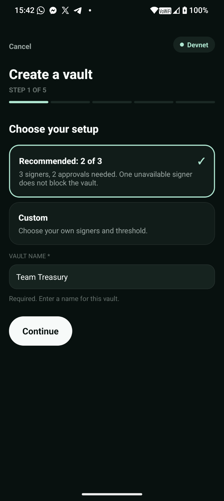
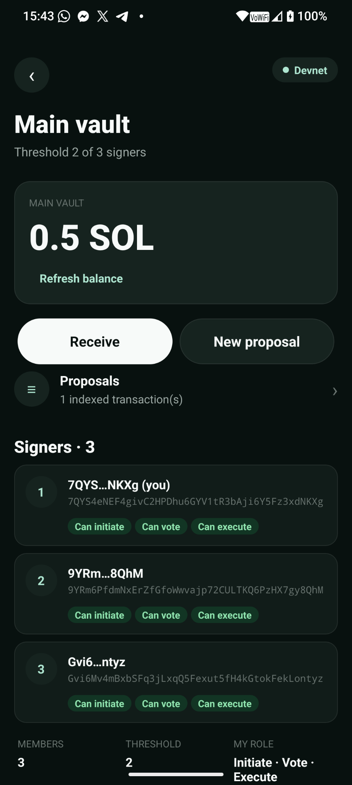
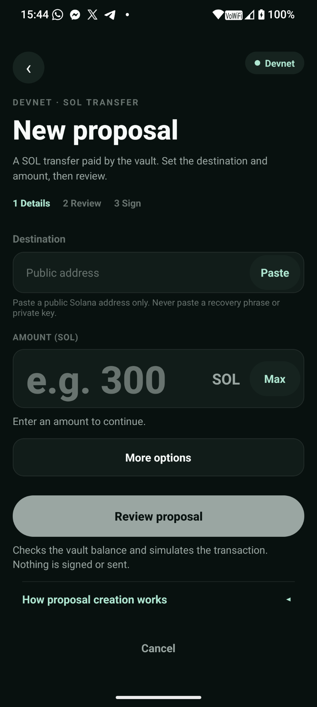
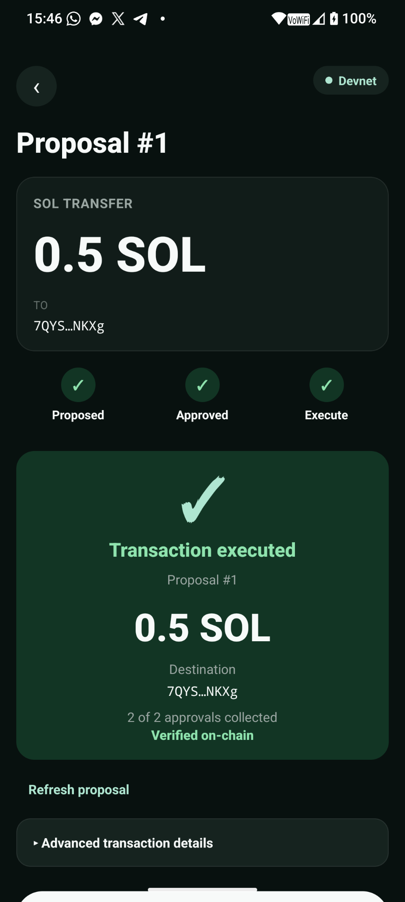

# Pocket Multisig

Android app to **create and manage a Squads Protocol v4 multisig from a
Solana Mobile phone (Seeker)**, via Mobile Wallet Adapter. Prototype built
for a hackathon.

> **DEVNET ONLY.** No mainnet network is reachable from this application. No
> transaction is signed without an explicit action by the user.

[English](#english) · [Français](#français)

---

## English

English is the primary language of this README because the app UI is in
English and the intended audience is an international (Solana hackathon) jury.

### Why Pocket Multisig

Managing a team treasury is a group activity: two signatures rather than one.
But voting still happens on a computer. Pocket Multisig brings proposal,
approval and execution **directly to Solana Seeker**: the keys never leave the
wallet, and every step is read back on-chain.

- Android, **devnet only**, Mobile Wallet Adapter + Squads Protocol v4.
- Four complete flows: create a multisig, propose, approve, execute.
- Recovery after a network drop without ever resending a transaction.

### Problem solved

A member of a Squads multisig currently has to use a desktop browser to look
at a proposal and vote. On a phone, no native tool lets you approve a
transaction from your multisig: the device can sign, the application was
missing. Pocket Multisig fills that gap while staying inside the phone's
security boundary: **the wallet keeps the keys**, the app reads on-chain state
and asks the wallet to sign.

### Features (devnet, manually validated on Seeker)

Four write flows, all with simulation, confirmation and read-back:

- **Create a multisig** — members, threshold, permissions; single signature by
  the creator; verified read-back (owner, threshold, members, permissions,
  timeLock, rentCollector) before showing “Vault created and verified”.
- **Create a proposal** — SOL transfer to an address; amount entered in SOL
  (exact conversion to lamports); simulation then a single transaction.
- **Approve** — a voter approves; three-level anti-double-approval; on-chain
  rejection if the wallet has already approved.
- **Execute** — as soon as the threshold is reached and the wallet has the
  `Execute` permission; balance re-read before sending; read-back of the
  proposal and the vault.

Plus, read-only:

- **Connect / disconnect** via Mobile Wallet Adapter (Seed Vault, Solflare,
  Ledger via Solflare).
- **Read a multisig** by its address: threshold, members, permissions, index 0
  vault address, Main vault balance.
- **Proposal list** and **proposal detail** (official message decoding, source,
  destination, amount).
- **Recovery after a network interruption**: `Check transaction again`
  (creation) and `Check approval again` (approval) — strictly read-only, no
  second send, with the same invariants as the initial read-back.

### Local vault registry

Several multisigs can be registered on the device at once:

- **My multisigs** — a list showing each vault's name, short address and
  threshold (“2 of 3”).
- **Switching** — jump from one vault to another from the list.
- **Archiving** — move vaults you no longer need out of the way into a
  collapsible **Archived** section.
- **Renaming** — give a vault a readable name.

The registry is local to the device; nothing is sent to a server.

### Learn tour

A guided, multi-step educational walkthrough that explains what a multisig is
and how proposal / approval / execution work. It has a **Skip** button and
honours the Android back button, so it never blocks a user in a hurry.

### Honest handling of network failures

When the app cannot verify a transaction, it **never claims** that the
transaction succeeded or failed. Instead it shows a **verification pending**
state: it explains that a send was signed, offers to **re-read the chain**
(“Check again”, strictly read-only) and **warns you not to recreate** a
proposal without checking first. The raw technical details remain available
under a collapsible section.

### Wallet switching

When you switch the signer in the app, the multisig and proposal state
**reloads immediately** — no restart required.

### Wallet help sheet

A small help sheet covers common wallet issues (for example, “A wallet won't
open?” → clear the Android “Open by default” preferences for the wallet).

### Version badge

The **About** line displays the version, read from `app.json` (never
hard-coded). Current version: **0.4.31**.

### Controlled devnet fixture

A **controlled** Squads v4 multisig is available on devnet (2/2, both members
belong to us):

- cluster: **devnet**
- multisig (configuration address):
  `BbNr77iyMyn8ipzX2PLGN8mDTCA1cMconfZSzzDcW7xi`
- index 0 vault:
  `GLcZLbQZpMed3m8dAFF7XtNEn4TjedeLGKZeJSAG6yGG`
- threshold: **2 / 2**, Initiate + Vote + Execute permissions for both members

All these addresses are **public devnet data, with no real value**.

### Tech stack

| Layer | Version |
| --- | --- |
| Expo | 57.0.24 |
| React Native | 0.86.3 |
| React | 19.2.3 |
| TypeScript (strict) | 6.0.3 |
| @solana/web3.js | 1.99.x (v1) |
| @sqds/multisig (Squads Protocol v4) | 2.1.4 |
| @wallet-ui/react-native-web3js (Mobile Wallet Adapter) | 4.3.0 |
| react-native-quick-crypto | 1.1.x |
| expo-dev-client | 57.0.x |

Squads Protocol v4 program: `SQDS4ep65T869zMMBKyuUq6aD6EgTu8psMjkvj52pCf`

### Simplified architecture

```
[ Seeker ]
    │  Mobile Wallet Adapter (Android session, signatures)
    ▼
[ Wallet MWA ] ──signs──► [ Pocket Multisig (Expo dev build) ]
                                │  JSON-RPC HTTPS
                                ▼
                    [ api.devnet.solana.com ]
                                │
                                ▼
            [ Squads Protocol v4 program ]
```

Three layers, no server infrastructure:

- the **wallet** holds the keys; the app never sees a private key;
- the **app** reads on-chain state and builds the instructions;
- the **chain** is the single source of truth (no backend, no database, no
  service key).

### Screenshots

> Image files live under `docs/screenshots/`. The README stays valid even if an
> image is missing.


*Create a multisig — recommended 2-of-3 setup.*


*The vault on-chain: balance, proposals and the 3 signers with their permissions.*


*Create a SOL transfer proposal and review it before signing.*


*Threshold reached — the transaction is executed and verified on-chain.*

### Demo & pitch

- Demo video: <!-- TODO: paste the video link -->
- Pitch deck: <!-- TODO: paste the pitch deck link -->

### Requirements

- Node.js 20+ and npm, JDK 17.
- Android SDK (`ANDROID_HOME`), `platform-tools`, `build-tools`, `android-36`.
- An Android device with an MWA-compatible wallet. **Expo Go does not work**
  (native Kotlin modules): a *development build* is required.

### Installation

```bash
git clone https://github.com/corentinladaique/pocket-multisig.git pocket-multisig
cd pocket-multisig
npm ci                      # or npm install
adb devices
npm run typecheck
npm test                    # pure tests (no network, no transaction)
npx expo run:android        # native build + install on the device
```

To install an already-built APK on a connected Seeker:

```bash
adb install -r <path>/app-release.apk
```

(`-r` keeps the app's data.)

On “SDK location not found”, create `android/local.properties` (a Git-ignored
file) containing `sdk.dir=/path/to/Android/Sdk`.

Scripts: `npm run typecheck`, `npm run doctor`, `npm test`, `npm run android`.

### Download / Install

No APK release is published yet. A **signed arm64 APK** will be attached to a
future release (`v0.4.31`) on the repository's Releases page:

- Releases: <https://github.com/corentinladaique/pocket-multisig/releases>

Until then, build and install the app locally (see *Installation* above).
Install the APK on a **Seeker (Android, arm64)**, either with
`adb install -r <file>.apk` or by opening the file on the phone.

### Usage

1. **Connect wallet**, authorize in the wallet.
2. Paste a multisig address and **Load multisig** (or **Create vault** to
   create one on devnet).
3. From the home screen: open proposals, **create** one, **approve** with a
   second wallet, **execute** once the threshold is reached.
4. After a network drop, **Check transaction again / Check approval again**
   lets you recover the on-chain state without resending anything.

### Demo flow

Reference demo (full detail and checklists: `DEMO-RUNBOOK.md`):

1. Configure a **2-of-3** vault and show the recommended threshold.
2. Create an SOL transfer proposal and re-read it before signing.
3. Have a second wallet approve → “Approval threshold reached”.
4. **Execute transaction** → “✓ Transaction executed”.
5. Optional, as an insert: cut the network, then `Check approval again`.

The main take never depends on a network drop.

### Security

- **Never give your seed phrase or private key to anyone, including this
  application.** It does not ask for them, does not read them and does not
  store them.
- No secrets in the repository: no `.env`, no API key, no token.
- This prototype **has not been audited.** See `SECURITY.md` for the rules
  applied and the **open risks** (single public RPC, development dApp identity,
  vulnerable transitive dependencies, unsupported dynamic address lists).

### Hackathon disclaimer

Prototype provided as-is, without warranty. Not audited. Do not use it to
manage assets of real value.

### Status

| Step | Status |
| --- | --- |
| Scoping, architecture, security | Done |
| Expo native base + polyfills | Done |
| MWA connect / disconnect | Validated on Seeker |
| Network state and devnet RPC | Validated on Seeker |
| Read multisig, proposals, decoding | Validated on Seeker |
| Multisig creation + verified read-back | Validated on Seeker |
| SOL proposal creation | Validated on Seeker |
| Approval + network recovery | Validated on Seeker |
| Execution | Validated on Seeker |
| Local vault registry (switch / archive / rename) | Validated on Seeker |
| Learn tour | Validated on Seeker |
| Pure tests (`npm test`) | 78 files, run manually |
| CI (pure tests + typecheck) | Implemented (GitHub Actions) |
| Automatic multisig discovery | Deferred after the MVP |

### Known limitations

- `expo-doctor` reports a duplicate transitive React dependency
  (`@wallet-standard/react`); no observed impact.
- Two installed MWA wallets make the Android selector appear on first
  connection.
- Address Lookup Tables are not supported at runtime.
- `LICENSE` is a plain MIT licence (copyright © 2026 Corentin Ladaique).

### Acknowledgements

Squads Protocol v4, Mobile Wallet Adapter, the Seed Vault wallet and the Seeker
device are projects by Solana Mobile / Squads Labs. This repository is neither
affiliated with nor endorsed by them.

---

## Français

[English](#english) · [Français](#français)

Ce dépôt est bilingue : la version anglaise (ci-dessus) est la version
principale, car l'interface de l'application est en anglais.

### Pourquoi Pocket Multisig

Gérer une trésorerie d'équipe, ça se fait à plusieurs : deux signatures plutôt
qu'une. Mais voter se fait encore sur un ordinateur. Pocket Multisig amène la
proposition, l'approbation et l'exécution **directement sur Solana Seeker** :
les clés ne sortent jamais du wallet, et chaque étape est relue on-chain.

- Android, **devnet uniquement**, Mobile Wallet Adapter + Squads Protocol v4.
- Quatre flux complets : créer un multisig, proposer, approuver, exécuter.
- Reprise après coupure réseau sans jamais renvoyer de transaction.

### Problème résolu

Un membre d'un multisig Squads doit aujourd'hui passer par un navigateur
desktop pour consulter une proposition et voter. Sur un téléphone, aucun outil
natif ne permet d'approuver une transaction de son multisig : l'appareil sait
signer, l'application manquait. Pocket Multisig comble ce vide en restant dans
le périmètre de sécurité du téléphone : **le wallet garde les clés**,
l'application lit l'état on-chain et fait signer.

### Fonctionnalités (devnet, validées manuellement sur Seeker)

Quatre flux d'écriture, tous avec simulation, confirmation et read-back :

- **Créer un multisig** — membres, seuil, permissions ; signature unique du
  créateur ; read-back vérifié (propriétaire, threshold, membres, permissions,
  timeLock, rentCollector) avant d'afficher « Vault created and verified ».
- **Créer une proposition** — transfert SOL vers une adresse ; montant saisi en
  SOL (conversion exacte en lamports) ; simulation puis une seule transaction.
- **Approuver** — un votant approuve ; anti-double-approbation à trois niveaux ;
  refus on-chain si le wallet a déjà approuvé.
- **Exécuter** — dès que le seuil est atteint et que le wallet a la permission
  `Execute` ; solde relu avant envoi ; read-back de la proposition et du vault.

Plus, en lecture seule :

- **Connexion / déconnexion** via Mobile Wallet Adapter (Seed Vault, Solflare,
  Ledger via Solflare).
- **Lecture d'un multisig** par son adresse : seuil, membres, permissions,
  adresse du vault index 0, solde du Main vault.
- **Liste des propositions** et **détail d'une proposition** (décodage officiel
  du message, source, destination, montant).
- **Reprise après interruption réseau** : `Check transaction again` (création)
  et `Check approval again` (approbation) — strictement en lecture, sans second
  envoi, avec les mêmes invariants que le read-back initial.

### Registre local de vaults

Plusieurs multisigs peuvent être enregistrés sur l'appareil :

- **My multisigs** — une liste affichant le nom, l'adresse courte et le seuil
  de chaque vault (« 2 of 3 »).
- **Bascule** — passer d'un vault à l'autre directement depuis la liste.
- **Archivage** — ranger les vaults dont vous n'avez plus besoin dans une
  section repliable **Archived**.
- **Renommage** — donner un nom lisible à un vault.

Le registre est local à l'appareil ; rien n'est envoyé à un serveur.

### Parcours « Learn »

Un parcours pédagogique en plusieurs étapes qui explique ce qu'est un multisig
et comment fonctionnent proposition / approbation / exécution. Il propose un
bouton **Skip** et respecte le bouton retour Android : il ne bloque jamais un
utilisateur pressé.

### Réponses honnêtes aux pannes réseau

Quand l'application n'a pas pu vérifier une transaction, elle **n'affirme
jamais** qu'elle a réussi ou échoué. Elle affiche un état **verification
pending** : elle explique qu'un envoi a été signé, propose de **relire la
chaîne** (« Check again », strictement en lecture) et **avertit de ne pas
recréer** une proposition sans vérifier au préalable. Les détails techniques
bruts restent disponibles dans un repli.

### Changement de wallet

Lorsque vous changez le signataire dans l'application, l'état du multisig et
des propositions **se recharge immédiatement** — aucun redémarrage nécessaire.

### Aide wallet

Une petite feuille d'aide couvre les problèmes courants (par exemple, « A
wallet won't open? » → effacer les préférences Android « Ouvrir par défaut »
du wallet).

### Badge de version

La ligne **About** affiche la version, lue depuis `app.json` (jamais codée en
dur). Version courante : **0.4.31**.

### Fixture devnet contrôlée

Un multisig Squads v4 **contrôlé** est disponible sur devnet (2/2, les deux
membres nous appartiennent) :

- cluster : **devnet**
- multisig (adresse de configuration) :
  `BbNr77iyMyn8ipzX2PLGN8mDTCA1cMconfZSzzDcW7xi`
- vault d'index 0 :
  `GLcZLbQZpMed3m8dAFF7XtNEn4TjedeLGKZeJSAG6yGG`
- seuil : **2 / 2**, permissions Initiate + Vote + Execute pour les deux membres

Toutes ces adresses sont des **données publiques de devnet, sans valeur
réelle**.

### Stack technique

| Brique | Version |
| --- | --- |
| Expo | 57.0.24 |
| React Native | 0.86.3 |
| React | 19.2.3 |
| TypeScript (strict) | 6.0.3 |
| @solana/web3.js | 1.99.x (v1) |
| @sqds/multisig (Squads Protocol v4) | 2.1.4 |
| @wallet-ui/react-native-web3js (Mobile Wallet Adapter) | 4.3.0 |
| react-native-quick-crypto | 1.1.x |
| expo-dev-client | 57.0.x |

Programme Squads Protocol v4 : `SQDS4ep65T869zMMBKyuUq6aD6EgTu8psMjkvj52pCf`

### Architecture simplifiée

```
[ Seeker ]
    │  Mobile Wallet Adapter (session Android, signatures)
    ▼
[ Wallet MWA ] ──signe──► [ Pocket Multisig (Expo dev build) ]
                                │  JSON-RPC HTTPS
                                ▼
                    [ api.devnet.solana.com ]
                                │
                                ▼
            [ Programme Squads Protocol v4 ]
```

Trois couches, aucune infrastructure serveur :

- le **wallet** détient les clés ; l'application ne voit jamais de clé privée ;
- l'**application** lit l'état on-chain et construit les instructions ;
- la **chaîne** est l'unique source de vérité (aucun backend, aucune base de
  données, aucune clé de service).

### Captures d'écran

> Les fichiers images se trouvent dans `docs/screenshots/`. Le README reste
> valide même si une image est absente.


*Créer un multisig — la configuration recommandée 2 sur 3.*


*Le vault on-chain : solde, propositions et les 3 signataires avec leurs permissions.*


*Créer une proposition de transfert SOL et la vérifier avant de signer.*


*Seuil atteint — la transaction est exécutée et vérifiée on-chain.*

### Demo & pitch

- Vidéo de démo : <!-- TODO: coller le lien de la vidéo -->
- Pitch deck : <!-- TODO: coller le lien du pitch deck -->

### Prérequis

- Node.js 20+ et npm, JDK 17.
- Android SDK (`ANDROID_HOME`), `platform-tools`, `build-tools`, `android-36`.
- Un appareil Android avec un wallet compatible MWA. **Expo Go ne fonctionne
  pas** (modules natifs Kotlin) : un *development build* est obligatoire.

### Installation

```bash
git clone https://github.com/corentinladaique/pocket-multisig.git pocket-multisig
cd pocket-multisig
npm ci                      # ou npm install
adb devices
npm run typecheck
npm test                    # tests purs (aucun réseau, aucune transaction)
npx expo run:android        # build natif + installation sur l'appareil
```

Installer un APK déjà construit sur un Seeker branché :

```bash
adb install -r <chemin>/app-release.apk
```

(`-r` conserve les données de l'application.)

En cas de « SDK location not found », créer `android/local.properties`
(fichier ignoré par Git) contenant `sdk.dir=/chemin/vers/Android/Sdk`.

Scripts : `npm run typecheck`, `npm run doctor`, `npm test`, `npm run android`.

### Téléchargement / Installation

Aucune release APK n'est encore publiée. Un **APK signé arm64** sera joint à une
future release (`v0.4.31`) sur la page Releases du dépôt :

- Releases : <https://github.com/corentinladaique/pocket-multisig/releases>

En attendant, construisez et installez l'application localement (voir
*Installation* ci-dessus). Installez l'APK sur un **Seeker (Android, arm64)**,
soit via `adb install -r <fichier>.apk`, soit en ouvrant le fichier sur le
téléphone.

### Utilisation

1. **Connect wallet**, autoriser dans le wallet.
2. Coller l'adresse d'un multisig et **Load multisig** (ou **Create vault**
   pour en créer un sur devnet).
3. Depuis l'accueil : ouvrir les propositions, en **créer** une, **approuver**
   avec un second wallet, **exécuter** quand le seuil est atteint.
4. Après une coupure réseau, **Check transaction again / Check approval again**
   permet de retrouver l'état on-chain sans rien renvoyer.

### Demo flow

Démo de référence (détail complet et checklists : `DEMO-RUNBOOK.md`) :

1. Configurer un vault **2-of-3** et montrer le seuil recommandé.
2. Créer une proposition de transfert SOL et la relire avant de signer.
3. Faire approuver par un second wallet → « Approval threshold reached ».
4. **Execute transaction** → « ✓ Transaction executed ».
5. Optionnel, en insert : couper le réseau puis `Check approval again`.

Le take principal ne dépend jamais d'une coupure réseau.

### Sécurité

- **Ne fournissez jamais votre seed phrase ou votre clé privée à quiconque, y
  compris à cette application.** Elle ne les demande pas, ne les lit pas et ne
  les stocke pas.
- Aucun secret dans le dépôt : aucun `.env`, aucune clé d'API, aucun token.
- Ce prototype **n'a pas été audité.** Voir `SECURITY.md` pour les règles
  appliquées et les **risques ouverts** (RPC public unique, identité dApp de
  développement, dépendances vulnérables transitives, listes d'adresses
  dynamiques non supportées).

### Avertissement hackathon

Prototype fourni tel quel, sans garantie. Non audité. Ne pas l'utiliser pour
gérer des actifs ayant une valeur réelle.

### État d'avancement

| Étape | Statut |
| --- | --- |
| Cadrage, architecture, sécurité | Terminé |
| Socle natif Expo + polyfills | Terminé |
| Connexion / déconnexion MWA | Validé sur Seeker |
| État réseau et RPC devnet | Validé sur Seeker |
| Lecture d'un multisig, des propositions, décodage | Validé sur Seeker |
| Création de multisig + read-back vérifié | Validé sur Seeker |
| Création de proposition SOL | Validé sur Seeker |
| Approbation + reprise réseau | Validé sur Seeker |
| Exécution | Validé sur Seeker |
| Registre local de vaults (bascule / archivage / renommage) | Validé sur Seeker |
| Parcours « Learn » | Validé sur Seeker |
| Tests purs (`npm test`) | 78 fichiers, lancés manuellement |
| CI (tests purs + typecheck) | Implémentée (GitHub Actions) |
| Découverte automatique des multisigs | Reportée après le MVP |

### Limitations connues

- `expo-doctor` signale une dépendance React dupliquée transitive
  (`@wallet-standard/react`) ; aucun impact observé.
- Deux wallets MWA installés font apparaître le sélecteur Android à la première
  connexion.
- Les Address Lookup Tables ne sont pas supportées à l'exécution.
- `LICENSE` est une licence MIT simple (copyright © 2026 Corentin Ladaique).

### Remerciements

Squads Protocol v4, Mobile Wallet Adapter, le wallet Seed Vault et l'appareil
Seeker sont des projets Solana Mobile / Squads Labs. Ce dépôt n'y est ni
affilié ni approuvé par eux.
